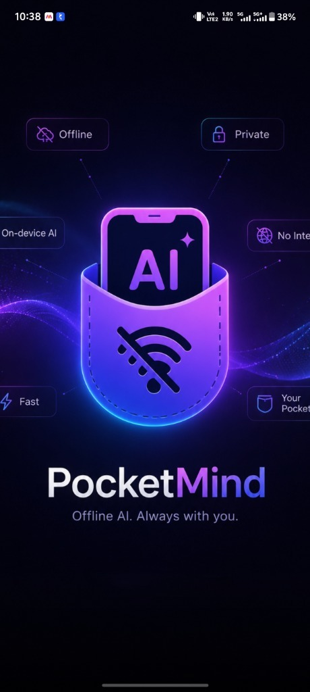
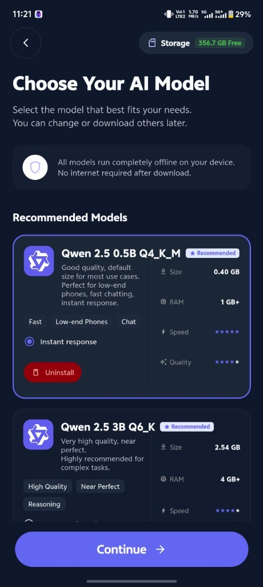
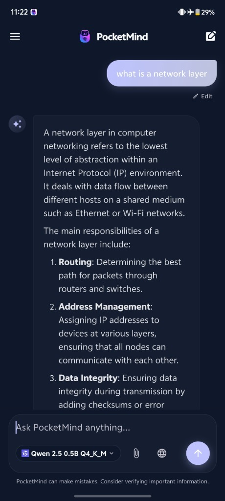
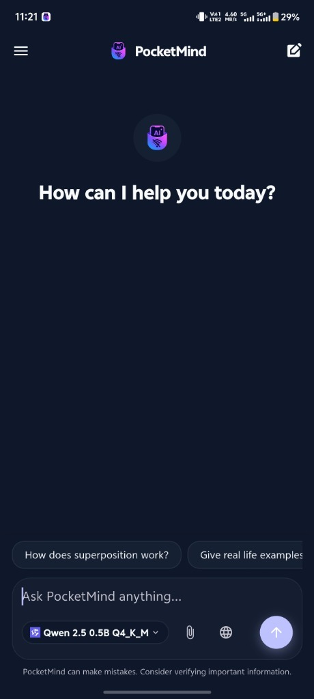
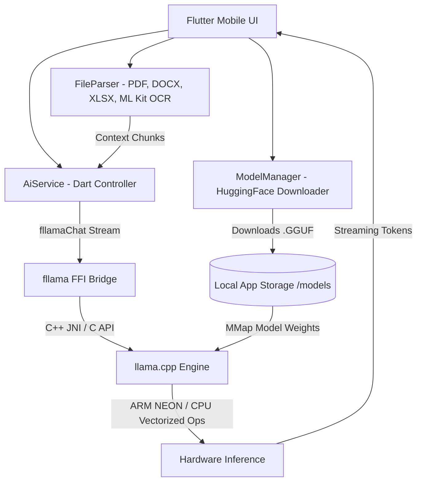

<h1 align="center">PocketMind</h1>

<p align="center">
  <strong>100% Private, Offline On-Device AI Assistant for Android & iOS</strong><br>
  <em>Powered by Flutter, llama.cpp, and GGUF Local LLMs.</em>
</p>

<p align="center">
  <a href="https://flutter.dev"></a>
  <a href="https://dart.dev"></a>
  <a href="https://github.com/ggerganov/llama.cpp"></a>
  <a href="LICENSE"></a>
  
  
</p>

<p align="center">
  <a href="#-key-features">Key Features</a> •
  <a href="#-app-screenshots">Screenshots</a> •
  <a href="#-supported-ai-models">Supported Models</a> •
  <a href="#-system-architecture">Architecture</a> •
  <a href="#-getting-started">Getting Started</a> •
  <a href="#-project-structure">Project Structure</a> •
  <a href="#-roadmap">Roadmap</a> •
  <a href="#-contributing">Contributing</a>
</p>

---

## 🌟 Overview

**PocketMind** is an open-source, production-ready mobile application that brings large language models (LLMs) directly into your pocket. Unlike traditional AI apps that stream your confidential data to third-party cloud servers, PocketMind performs **100% of the inference on-device using llama.cpp**. 

No internet connection required. No subscription fees. Zero tracking. Complete privacy.

Whether you're on an airplane, in a remote location, or simply value your digital sovereignty, PocketMind provides an intelligent AI assistant right at your fingertips.

---

## ✨ Key Features

- 🔒 **Zero-Cloud Privacy (Air-Gapped Capable):** Everything runs natively on your phone. Prompts, documents, OCR extracts, and chat histories never leave your device.
- ⚡ **High-Performance On-Device Inference:** Integrated with [llama.cpp](https://github.com/ggerganov/llama.cpp) via `fllama`, optimized with ARM NEON / mobile CPU acceleration.
- 📥 **Integrated Model Manager:** Download, pause, resume, and switch between state-of-the-art quantized GGUF models (Qwen 2.5, Gemma 2, Mistral, TinyLlama) directly from HuggingFace.
- 📊 **Smart Hardware Detection:** Real-time RAM requirement alerts, speed benchmarks, and storage space monitoring to ensure smooth operation on any phone.
- 📄 **On-Device Document & Image RAG (Chat with Files):**
  - **PDF Documents:** Extract and question PDF files via `syncfusion_flutter_pdf`.
  - **Word & Excel:** Read `.docx` and `.xlsx` sheets locally.
  - **OCR Vision (Google ML Kit):** Snap or upload images of text and extract content on-device.
- 🗣️ **Text-to-Speech (TTS):** Listen to AI responses with natural speech audio using `flutter_tts`.
- 🎨 **Sleek Modern Glassmorphic UI:** Built with Flutter, featuring deep dark mode, smooth streaming token animations, and full Markdown code highlighting.

---

## 📸 App Screenshots

<table align="center">
  <tr>
    <td align="center" width="33%">
      <br>
      <b>Splash / Welcome</b>
    </td>
    <td align="center" width="33%">
      <br>
      <b>In-App Model Manager</b>
    </td>
    <td align="center" width="33%">
      <br>
      <b>Local Offline Inference</b>
    </td>
  </tr>
  <tr>
    <td align="center" colspan="3">
      <br>
      <b>Clean Glassmorphic Chat Interface</b>
    </td>
  </tr>
</table>

---

## 🧠 Supported AI Models

PocketMind supports any **GGUF** quantized model compatible with `llama.cpp`. The built-in downloader comes preconfigured with tested, high-performing mobile models:

| Model Name | Quantization | Download Size | Minimum RAM | Recommended For | Speed Rating |
| :--- | :---: | :---: | :---: | :--- | :---: |
| **Qwen 2.5 0.5B Instruct** | `Q4_K_M` | ~400 MB | **1 GB+** | Budget & low-end phones, rapid replies | ⚡⚡⚡⚡⚡ |
| **Qwen 2.5 3B Instruct** | `Q6_K` | ~2.54 GB | **4 GB+** | Advanced reasoning & complex Q&A | ⚡⚡⚡⚡ |
| **Gemma 2 2B IT** | `Q8_0` | ~2.60 GB | **4 GB+** | Maximum 2B intelligence, balanced | ⚡⚡⚡⚡ |
| **Mistral 7B Instruct v0.2** | `Q4_K_M` | ~4.37 GB | **6 GB+** | Flagship phones, long-form writing | ⚡⚡⚡ |
| **TinyLlama 1.1B Chat** | `Q2_K` | ~483 MB | **1 GB+** | Ultra-lightweight conversational | ⚡⚡⚡⚡⚡ |

> [!TIP]
> **Need a different model?** You can easily add any compatible `.gguf` link directly in [`lib/model_manager.dart`](lib/model_manager.dart) or transfer `.gguf` files directly to your phone's storage.

---

## 🏗️ System Architecture



---

## 🚀 Getting Started

### Prerequisites

Ensure your development environment meets the following requirements:

1. **Flutter SDK:** Version `>= 3.11.5` ([Install Flutter](https://docs.flutter.dev/get-started/install))
2. **Android NDK & CMake:**
   - In Android Studio: `Settings > Appearance & Behavior > System Settings > Android SDK > SDK Tools`.
   - Check **NDK (Side by side)** and **CMake**.
3. **Physical Android Device:** Recommended over emulators for real ARM hardware inference testing (4 GB+ RAM recommended).

---

### Installation & Run

1. **Clone the repository:**
   ```bash
   git clone https://github.com/omavcher/pocketmind-offline-ai.git
   cd pocketmind-offline-ai
   ```

2. **Install Flutter dependencies:**
   ```bash
   flutter pub get
   ```

3. **Firebase Configuration (Optional):**
   PocketMind supports optional Firebase Google Sign-In and profile sync.
   - For open-source testing without Firebase, a template is provided at [`android/app/google-services.json.example`](android/app/google-services.json.example).
   - Copy or rename it:
     ```bash
     cp android/app/google-services.json.example android/app/google-services.json
     ```

4. **Connect your phone and run:**
   ```bash
   flutter run --release
   ```
   *(Note: `--release` mode is strongly recommended for optimal C++/llama.cpp inference speed).*

---

## 📁 Project Structure

```text
pocketmind/
├── android/                   # Native Android wrapper & NDK configurations
├── assets/                    # App icons, splash screens, brand logos
│   └── images/
├── docs/                      # Documentation assets & screenshots
│   └── screenshots/
│       ├── hero_splash.jpg
│       ├── model_selection.jpg
│       ├── chat_empty.jpg
│       └── chat_active.jpg
├── lib/                       # Flutter Core Application
│   ├── ai_service.dart        # llama.cpp stream management & prompt templates
│   ├── model_manager.dart     # GGUF models catalogue, downloader & storage
│   ├── file_parser.dart       # Local PDF, Word, Excel & ML Kit OCR extraction
│   ├── auth_service.dart      # Optional authentication & user preferences
│   ├── onboarding.dart        # First-run guided setup & model selection
│   ├── profile.dart           # User profile & storage management
│   └── main.dart              # Main UI, chat interface & token streaming
├── .github/                   # CI/CD Workflows & Issue Templates
│   ├── workflows/flutter_ci.yml
│   └── ISSUE_TEMPLATE/
├── CONTRIBUTING.md            # Guidelines for open-source contributors
├── CODE_OF_CONDUCT.md         # Community code of conduct
├── SECURITY.md                # Privacy & vulnerability disclosure policy
├── LICENSE                    # MIT License
└── pubspec.yaml               # Project dependencies and metadata
```

---

## 🛣️ Roadmap

- [ ] **GPU Backend Acceleration:** Vulkan / OpenCL backend support on supported Adreno & Mali GPUs.
- [ ] **iOS Metal Acceleration:** Optimizing for Apple Silicon A-series chips.
- [ ] **On-Device Whisper STT:** Integrated local speech-to-text without cloud transcription.
- [ ] **Vector Database & Full Local RAG:** On-device embeddings (`bge-small` / `nomic-embed`) with SQLite vector indexing.
- [ ] **Tool Use & Function Calling:** Enabling offline calculator, calendar, and system task execution.

---

## 🤝 Contributing

Contributions are what make the open-source community such an amazing place to learn, inspire, and create. Any contributions you make are **greatly appreciated**!

Please review our [**Contributing Guidelines**](CONTRIBUTING.md) and [**Code of Conduct**](CODE_OF_CONDUCT.md) before submitting pull requests.

1. Fork the Project
2. Create your Feature Branch (`git checkout -b feature/AmazingFeature`)
3. Commit your Changes (`git commit -m 'feat: Add some AmazingFeature'`)
4. Push to the Branch (`git push origin feature/AmazingFeature`)
5. Open a Pull Request

---

## 📜 License

Distributed under the **MIT License**. See [`LICENSE`](LICENSE) for more information.

---

## 🙏 Acknowledgments

- [llama.cpp](https://github.com/ggerganov/llama.cpp) by Georgi Gerganov for pioneer on-device LLM inference.
- [fllama](https://github.com/Telosnex/fllama) for Flutter bindings to llama.cpp.
- [Hugging Face](https://huggingface.co/) and model creators (`Qwen`, `Google Gemma`, `Mistral AI`, `TheBloke`, `bartowski`) for making open weights accessible to the world.
- The Flutter community for high-quality open-source packages.

---

<p align="center">
  Made with ❤️ for Privacy & Open Source AI
</p>
